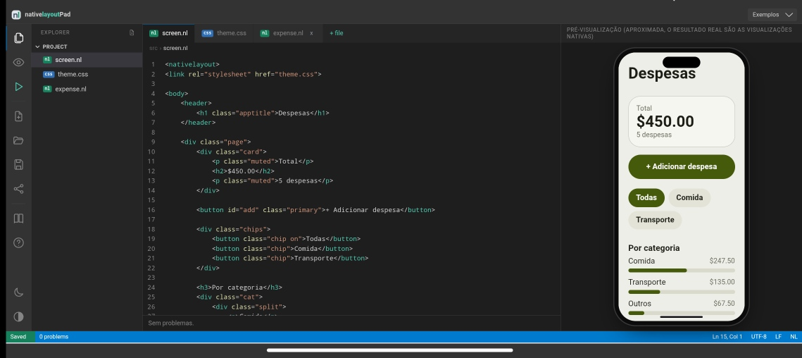

<div align="center">

<h1>NativeLayoutPad</h1>

<p><strong>Write a <code>.nl</code> screen and see it live, in your browser.</strong></p>

<p><a href="https://nativelayoutpad.vercel.app/"><strong>Open the online editor</strong></a> &middot; <a href="https://github.com/getnativelayout/nativelayout">nativelayout</a> &middot; <a href="https://github.com/getnativelayout/nativelayout/blob/main/SPEC.md">Specification</a></p>

</div>

<br>

<p align="center">
  <a href="https://nativelayoutpad.vercel.app/">
    
  </a>
</p>

<p align="justify">
NativeLayoutPad is the online editor of <a href="https://github.com/getnativelayout/nativelayout">nativelayout</a>. Write a <code>.nl</code> file, with its styles and data, and see the screen as you type. Nothing to install, and it works offline.
</p>

<p align="justify">
The preview is approximate: the real result is native views on the device. It shows the layout only. Taps and state logic stay in your program, as in nativelayout itself.
</p>

## Features

- **Editor** with syntax highlighting for `.nl`, `.css` and `.json`, several files, line numbers and a breadcrumb.
- **Live preview** that updates while you type, with a light and a dark theme.
- **Problems panel** with the line of each error and warning. Click one to jump to the line.
- **Built-in icons.** `` is drawn in the preview, in the text color.
- **Optional `data.json`.** Names used in the layout that have no data get sample values. A button in the status bar opens a dialog to fill them in and saves them to `data.json`.
- **Examples** you can load in one tap.
- **Share link** that carries your files in the address.
- **Installable and offline** (PWA). After the first visit it works without internet, preview included.
- **Mobile first.** On a phone the code and the preview take turns; on a wide screen they sit side by side, with a draggable divider.

## How it works

<p align="justify">
The engine is the nativelayout core compiled to JavaScript (<code>pad/nlweb.js</code>), so the preview runs the same code as the Android host. It exposes one function, <code>nlRender(screen, files, data, dark)</code>, which returns the HTML of the screen and the warnings. The rest of this repository is the interface around it.
</p>

> `pad/nlweb.js` is generated from the core. Do not edit it by hand: update it when the core changes.

## Install as an app

Open the editor in Chrome or another browser that supports PWAs, then use the menu and choose **Install app** (or **Add to home screen**). It needs HTTPS, which Vercel provides.

## Run locally

It is a static site, with no build step. Any static server works:

```
npx serve .
# or
python3 -m http.server 8000
```

Open `http://localhost:8000`. Offline mode works on `localhost` and on HTTPS, not on plain `http` addresses.

## Repository layout

```
index.html              the page
sw.js                   service worker (offline); must stay next to index.html
manifest.webmanifest    PWA manifest
pad/
  nlweb.js              the engine (nativelayout core compiled to JS)
  editor.js             editor, files, highlighting, preview
  ui.js                 interface: breadcrumb, status bar, divider
  icons.js              built-in icons drawn in the preview
  auto.js               sample data for names missing in data.json
  vars.js               dialog that fills those names and saves data.json
  pwa.js                registers the service worker
  base.css, ide.css     styles
  app-icons/            app icons and the editor screenshot
  exemplos/             examples (index.json + one folder per example)
```

## Examples

<p align="justify">
Examples live in <code>pad/exemplos/</code>. The file <code>index.json</code> lists them, and each one is a folder with its <code>screen.nl</code> and, if needed, a <code>theme.css</code> and a <code>data.json</code>:
</p>

```json
[
  { "name": "Tasks", "folder": "tasks" },
  { "name": "Expenses", "folder": "expenses", "files": ["screen.nl", "theme.css", "data.json"] }
]
```

If the catalog cannot be read, the editor falls back to the examples built into the page.

## Deploy

<p align="justify">
Connect the repository to Vercel as a static project (no build command, output directory at the root). To publish a new version that installed apps must pick up, raise <code>CACHE</code> in <code>sw.js</code> (for example from <code>nlpad-v1</code> to <code>nlpad-v2</code>). Installed apps update on the next open.
</p>

## Contributing

<p align="justify">
Issues and pull requests are welcome. Questions and ideas go to the <a href="https://discord.gg/638USuPnpk">Discord community</a>. Changes to the language itself belong in the <a href="https://github.com/getnativelayout/nativelayout">nativelayout</a> repository.
</p>

## License

<p align="justify">
Copyright (c) 2026 Adilson C. Rafael. Licensed under the <a href="https://mozilla.org/MPL/2.0/">Mozilla Public License 2.0</a>. The names <em>nativelayout</em> and <em>getnativelayout</em>, and the logo, are not covered by this license.
</p>
